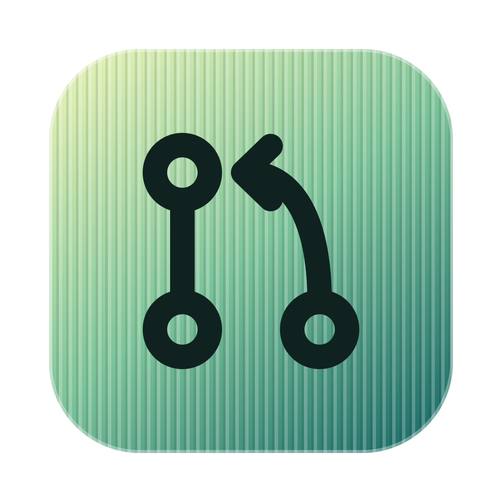
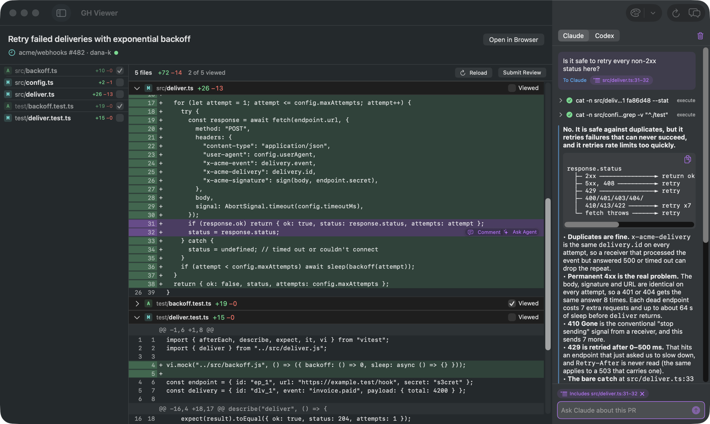
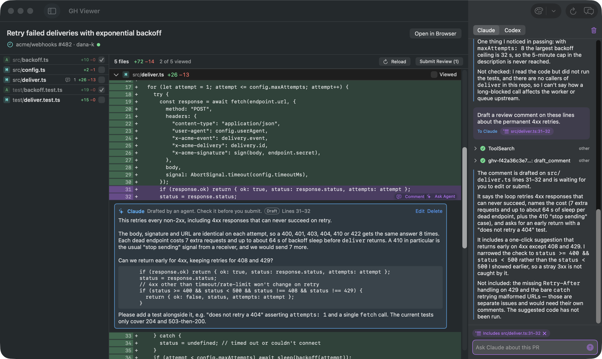
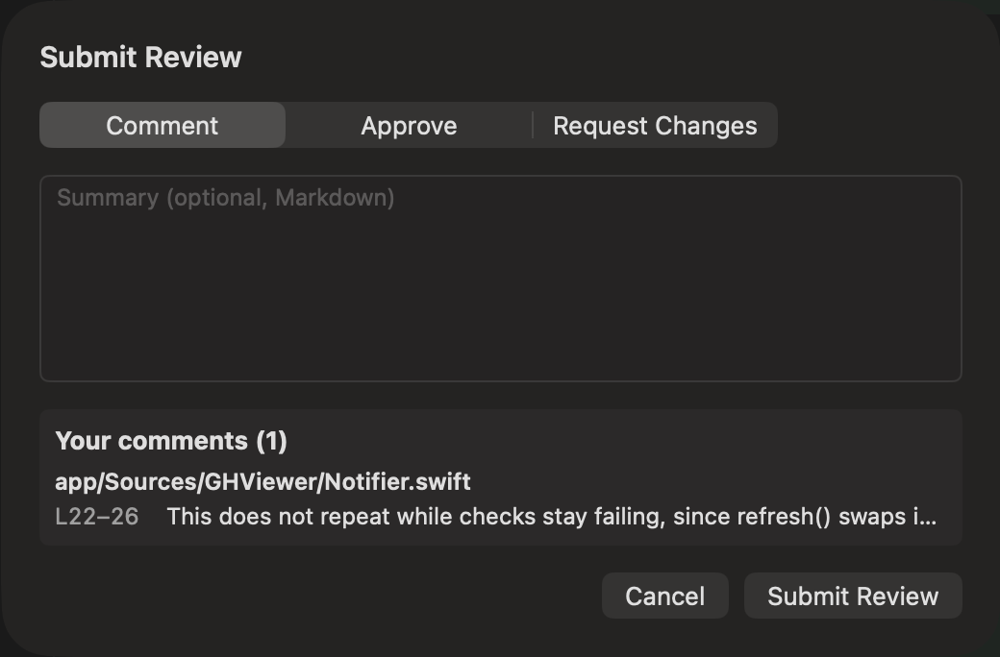

<p align="center">
  
</p>

<h1 align="center">GH Viewer</h1>

<p align="center">
  <strong>Review GitHub pull requests in a native Mac app, with your coding agent beside the diff.</strong>
</p>

<p align="center">
  
  
  
  <a href="LICENSE"></a>
</p>

<p align="center">
  <a href="#quick-start">Quick start</a> ·
  <a href="#features">Features</a> ·
  <a href="#privacy-and-safety">Privacy</a> ·
  <a href="#how-it-works">How it works</a> ·
  <a href="#development">Development</a>
</p>

<p align="center">
  
</p>

GH Viewer lives in your menu bar and shows the pull requests waiting on you.
Open one and you get a fast, native diff from a local checkout, with Claude Code
or Codex next to it. Select lines and ask about them: the agent runs in the PR's
checkout, so it can read the callers and run the tests. Ask it to review the
changes and it drafts comments for you to edit or throw away. Nothing reaches
GitHub until you submit.

## Quick start

You need macOS 14 or later and the [GitHub CLI](https://cli.github.com), signed in.

```sh
brew install gh && gh auth login       # once
xcode-select --install                 # once, if you don't have the Command Line Tools
curl https://sh.rustup.rs -sSf | sh    # once, if you don't have Rust

git clone https://github.com/Castruu/gh-viewer.git
cd gh-viewer
scripts/build.sh --open
```

The icon appears in your menu bar with the number of PRs waiting on your review.
Click a PR to open it, or press **⌘O** in the menu for the review window.
To keep the app, copy `build/GHViewer.app` to `/Applications`.

For the agent chat, also install [Node.js](https://nodejs.org) and sign in to
[Claude Code](https://code.claude.com) and/or [Codex](https://github.com/openai/codex).
There's nothing to configure in GH Viewer.

## Features

### Your review queue, one click away


The menu bar shows the PRs that wait on your review (the icon shows how many)
and your own open PRs, five of each, with a link to the window for the rest.
Click one to review it, right-click to open it in your browser.

Each row has the review decision as an icon on the left (approved, changes
requested, review required, or none yet), then what the PR does (a `feat(x):`
prefix is left out), its repo, number, author and age. A status in words shows when there is news: Checks failing,
Changes requested, Draft, Approved or Checks running.

It refreshes every 2 minutes (every 10 in Low Power Mode), and when you open the
menu if the data is more than 30 seconds old. **⌘R** refreshes now. A notification
tells you about a new review request, a re-request, and checks that start failing
on your own PR. Click it to open that PR. macOS asks once whether to allow
notifications, and Settings turns them off.

Colors follow the theme you pick in Settings (**⌘,** with the review window open):
Cool, Soft, Focus or Vivid, in light or dark. Settings also has four app icons
to pick from for the Dock.

<br clear="right">

### A diff that keeps up with you


- The sidebar lists your PRs by what they need: your review, your own, and the
  ones you've already reviewed. Its filter button hides the sections, or the
  viewed files, you don't need to see.
- The window opens on the PR you had open last, or the first one waiting on
  you, and moves to the next one after you submit a review. That next PR is
  fetched ahead, so it's there when you get to it.
- The PR's description sits under its title, one line until you open it. Failing
  checks are named there, each a link to its run.
- The open PR's files are a folder tree beside the diff, with folders closed
  until you open them and a checkmark on the files you've viewed. The button on
  the tree folds it away (**⇧⌘F**).
- A unified diff computed from a local checkout, not fetched from GitHub's API,
  with basic syntax colors. An edited line marks the part that changed.
- "Viewed" checkboxes sync with GitHub. Viewed files start collapsed, and so do
  very large files, lock files, generated files and long data files.
- After you've reviewed a PR, "Since Your Review" narrows it to the files that
  changed since.
- Review threads from GitHub, placed on the lines they're about.
- Hover a diff line for the "+", then click the line to comment on it or ask
  the agent about it.
- The Review menu steps through a review from the keyboard: next and previous
  file (**⌥⌘↓**, **⌥⌘↑**), mark viewed (**⌥⌘V**), comment (**⌥⌘C**), ask the agent
  (**⌥⌘A**), submit (**⇧⌘↩**).
- The agent chat sits beside the diff. Close it from the toolbar and it stays closed.

### An agent that has read the code

- Select lines and ask Claude Code or Codex about them, or start from
  _Summarize this PR_, _What could break?_ or _Review the changes and draft
  comments_.
- The agent works in a checkout of the PR, with your own login and permission
  settings. It can open other files, follow callers and run commands.
- Switch between Claude and Codex per question.

### Comments you control





- Select lines to draft a comment yourself, or let the agent draft them. The agent
  writes replacement code as a GitHub suggestion the author can apply in one click.
- Drafts are saved locally until you submit. Edit or delete any of them.
- Submit them as one review: comment, approve or request changes.
- Agent drafts are labeled as such, here and in the diff, so you check them
  before they go out.

<br clear="right">

## Privacy and safety

- **No token storage.** GH Viewer reads your token from `gh auth token` on each
  refresh and never stores it.
- **No agent credentials.** Claude Code and Codex run with your own logins,
  through their [ACP](https://agentclientprotocol.com) adapters
  (`@agentclientprotocol/claude-agent-acp`, `@agentclientprotocol/codex-acp`).
  Each agent's own permission settings apply. GH Viewer's review tools are the
  one exception, allowed automatically: they read the PR and its review threads,
  and write drafts on your Mac.
- **Nothing is posted until you submit.** Agent drafts stay on your Mac.
- **Your data stays local.** Clones, per-PR worktrees, drafts and chats live in
  `~/Library/Application Support/GHViewer`. To reclaim disk space, delete the
  `repos` and `worktrees` folders there while the app isn't running.
- **What it fetches without a click.** The review window loads the PR it opens
  on and the next one waiting on your review, which clones their repos the first
  time. In Low Power Mode it skips the one ahead. At most six PRs keep their diff
  in memory.

## How it works

```
             menu bar + review window (SwiftUI)
                            │  UniFFI
                            ▼
                    ghv_core (Rust)
     ┌──────────────┬───────┴──────┬─────────────────┐
     ▼              ▼              ▼                 ▼
 GitHub GraphQL   git clone +    ACP client ──▶  Claude Code / Codex
 (token from gh)  worktree       (agent.rs)          │
 lib.rs, pr.rs    per PR                             │ review tools
                  checkout.rs    MCP server ◀────────┘
                                 on localhost (mcp.rs)
```

```
app/    SwiftUI app (menu bar + review window). Thin: UI and state only.
core/   Rust library, exported via UniFFI:
          lib.rs       GitHub GraphQL client, dashboard
          pr.rs        PR detail, threads, checks, viewed state, drafts, review submission
          checkout.rs  blobless clones, a worktree per PR, local diff
          agent.rs     ACP client for Claude Code and Codex
          mcp.rs       localhost MCP server with the agents' review tools
          review.rs    ties them together for the window
docs/design.md  decisions and data flows for the review window
uniffi-bindgen/  Generates the Swift bindings for core.
scripts/build.sh  cargo build -> generate bindings -> swift build -> .app bundle
scripts/make-icon.swift  renders an icon's SVG to .icns or .png, adding its grain
```

## FAQ

**macOS asks GH Viewer for access to my Documents folder.**
Agents run as part of GH Viewer, so macOS asks GH Viewer when your agent or one
of its hooks reads a protected folder such as `~/Documents`. The agent waits
until you answer. The build is ad-hoc signed and that signature changes with
every build, so each new build asks again.

**Can I use it on a machine other than the one that built it?**
The ad-hoc signature is fine for running on the machine that built it. There
are no signed releases yet.

**Does it work with GitHub Enterprise?**
Not yet: it talks to github.com.

## Development

Requirements: Rust (stable) and the Xcode Command Line Tools
(`xcode-select --install`). Full Xcode is not required.

```sh
scripts/build.sh          # builds build/GHViewer.app
scripts/build.sh --open   # builds, quits any running copy and launches it
```

The build script generates `app/Sources/ghv_coreFFI`, `app/Sources/GHViewer/Generated`
and `app/RustLib`. They're git-ignored, so run the script before `swift build`
or opening `app/` in an editor.

`open build/GHViewer.app --args --open-review-window [<PR URL>]` opens the
review window at launch, optionally with a PR from your lists selected.

The app icon's source is `docs/assets/icon.svg`. The four icons to pick from in
Settings are in `docs/assets/icons`. Render them after a change:

```sh
swift scripts/make-icon.swift                                               # app/AppIcon.icns
swift scripts/make-icon.swift docs/assets/icons/moss.svg app/Icons/icon-moss.png
```

### Tests

```sh
cargo test -p ghv_core                    # unit and local integration tests
cargo test -p ghv_core -- --ignored       # live: GitHub (read-only) and your Claude/Codex logins
swift test --package-path app             # app logic; run scripts/build.sh first
```

The live submit tests post real reviews and push commits, so they only run on
a PR you name, one of yours that's safe to review:
`GHV_LIVE_SUBMIT_PR=owner/repo#n cargo test -p ghv_core live_submit -- --ignored --test-threads=1`.
See `mod live_submit` in `core/src/review.rs` for what it needs.

With only the Command Line Tools installed (no Xcode), swift-testing sits outside
SwiftPM's search paths, so pass them to `swift test`:

```sh
T=/Library/Developer/CommandLineTools/Library/Developer
swift test --package-path app -Xswiftc -F$T/Frameworks \
    -Xlinker -rpath -Xlinker $T/Frameworks -Xlinker -rpath -Xlinker $T/usr/lib
```

## License

MIT. See [LICENSE](LICENSE).
